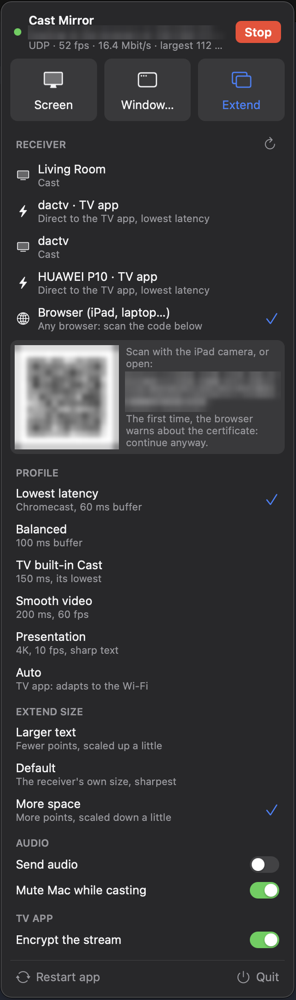

# cast-mirror

Low-latency screen mirroring from a Mac to a Chromecast, a TV with Cast built in, an Android TV or phone, or
any browser (iPad, iPhone, laptop). A menu bar app, written in Rust: ScreenCaptureKit capture, VideoToolbox
hardware encoding, no Chrome needed.



- **Cast Streaming** (the protocol of Chrome's "Cast screen") to any Cast receiver: ~100 ms on a Chromecast in
  the TV's Game mode, against ~300 ms from Chrome.
- **TV app**: a small receiver app for Android TV and phones (`android/`), ~70-90 ms end to end, encrypted.
- **Browser**: scan a QR code on the iPad or iPhone, 60 fps over WebRTC, no app to install.
- **Screen, a single window, or Extend**: Extend adds a virtual second monitor at the receiver's exact size.
- Audio, latency profiles, and an automatic quality mode that follows the Wi-Fi.

<br clear="right">

## Install

Needs macOS 14 or later.

**Download:** the [releases](../../releases) have `CastMirror.app` (Apple silicon) and the Android receiver
`cast-mirror-receiver.apk`. The app is not notarized, so macOS blocks the first start: run
`xattr -dr com.apple.quarantine CastMirror.app` once, or open it with a right click → Open.

**Build from source:** needs the Xcode command line tools and a current stable Rust.

```sh
scripts/bundle-app.sh            # builds ~/Applications/CastMirror.app and signs it
open ~/Applications/CastMirror.app
```

On the first cast, macOS asks for the **Screen Recording** permission: grant it, then pick **Restart app** in the
window. Ad-hoc signed builds lose that permission with every rebuild; `docs/technical.md` ("Signing") shows how to
sign with a local certificate so the permission stays.

## Use

Click the menu bar icon to open the window.

1. **Pick a receiver.** Cast devices on your network show up by themselves. A device running the TV app shows up
   a second time as "<name> · TV app" (the fastest path). **Browser** shows a link and a QR code.
2. **Pick what to show:** **Screen** mirrors a display, **Window…** opens the macOS window picker, **Extend**
   creates a second monitor. Drag windows onto it; they move back when casting stops.
3. **Stop** ends it. Picking another source while casting switches over.

Below the receivers:

- **Profile**: the trade-off between latency and smoothness. *Lowest latency* suits a Chromecast in Game mode,
  *TV built-in Cast* a TV's own Cast app (which buffers ~150 ms anyway), *Presentation* sends 4K text at 10 fps,
  *Auto* lets the TV app adapt to the Wi-Fi.
- **Extend size**: *Larger text*, *Default* (sharpest) or *More space* for the virtual monitor.
- **Audio**: send the Mac's sound to the receiver, and mute the Mac meanwhile.
- **Encrypt the stream** (TV app): on by default; switch it off only to inspect packets.

### Browser (iPad, iPhone, laptop)

Pick **Browser**, scan the QR code with the camera (or open the link), and accept the certificate warning once
(the certificate is self-signed; the secret in the link is the access check). Then start Screen, Window… or
Extend. The page follows rotation and fullscreen. On the iPhone, Safari allows fullscreen only for videos, so add
the page to the Home Screen for a full view. Needs a browser with WebCodecs (Safari 16.4+, Chrome, Edge).

### TV app (Android TV, Android phones)

Install `cast-mirror-receiver.apk` (Android 9 or later), e.g. over network ADB:

```sh
adb connect <tv-ip>:5555
adb install -r cast-mirror-receiver.apk
```

Open the app on the TV. It then shows up in the menu bar window. The first cast asks for the code the TV shows;
after that, the Mac and the TV recognize each other. If network ADB stays authorized, the Mac starts the app
by itself. Video only for now, no audio.

### Command line

The app's binary also works in a terminal (it needs the Screen Recording permission there too):

```sh
cast-mirror scan                          # list Cast receivers
cast-mirror "TV" --stats                  # mirror display 0 to a Cast device, with live stats
cast-mirror tv --window safari            # only one window
cast-mirror 192.168.1.50 --direct --fps 60 --codecs hevc   # to the TV app
cast-mirror pair 192.168.1.50             # pair with the TV app once
cast-mirror web --fps 60 --bitrate 20M    # browser receiver; prints the link
cast-mirror web --extend                  # a second monitor in the browser
```

`cast-mirror --help` lists all options (bitrate, size, playout delay, codecs, …).

## Build the TV app

`android/build.sh` builds and signs the APK without Gradle. It needs the Android SDK (build-tools 34, platform 34)
and JDK 17; `android/build.sh install <ip>` also installs and starts it over ADB.

## More

- [docs/performance.md](docs/performance.md): latency per receiver and what it depends on.
- [docs/technical.md](docs/technical.md): protocol details, encryption and pairing, and the test setup with
  Open Screen's reference receiver.

## License

MIT, see [LICENSE](LICENSE). `vendor/chromiacast` is MIT too and includes parts of Open Screen (BSD); see its
`THIRD_PARTY_NOTICES.md`.
